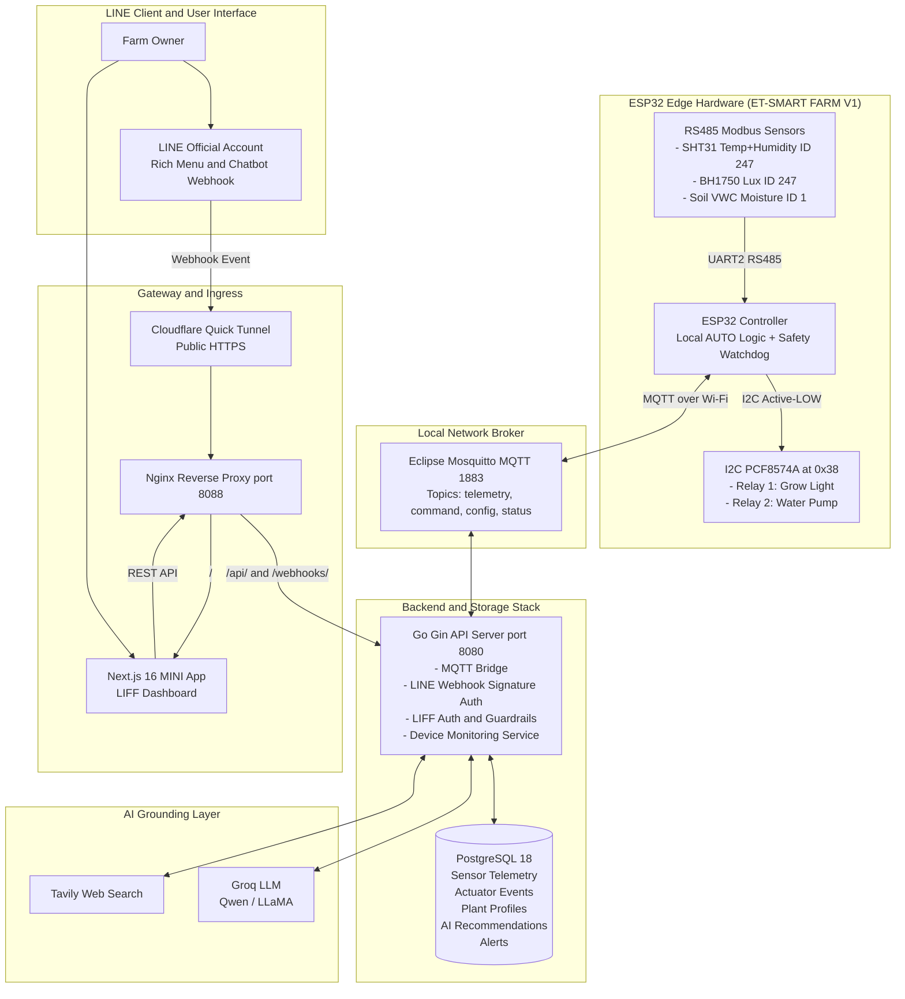

# CubeFarm / Smart Farm 🌱

[](https://golang.org)
[](https://nextjs.org)
[](https://espressif.com)
[](https://mqtt.org)
[-00C300?style=flat&logo=line)](https://line.me)
[](https://www.docker.com)

> 🌐 **Language / ภาษา**: **English** | [🇹🇭 ภาษาไทย (README.th.md)](README.th.md)

---

### 1. Overview & Philosophy

**CubeFarm (Smart Farm)** is an industrial-grade, safety-first IoT indoor agricultural automation system. Designed around the **ESP32 microcontroller**, it reads environmental telemetry through **Modbus RTU RS485 industrial sensors** and controls high-power loads (grow lights and irrigation pumps) via isolated I2C relays. 

The system integrates seamlessly with **LINE** via a mobile-first **LINE MINI App (LIFF)** and **LINE Official Account (Bot & Rich Menu)**, while leveraging **Groq AI (LLMs) & Tavily search grounding** for plant profile recommendations.

#### Core Principles
- **Safety-First & Local-First Autonomy**: The ESP32 executes automation decisions (light cycle, moisture threshold, soak cooldown, maximum pump runtimes) completely locally. If the cloud, server, or Wi-Fi fails, the farm continues operating safely.
- **Strict Separation of AI & Actuation**: AI models recommend optimal parameters based on live web research, but **never** directly trigger physical actuators. All AI suggestions require human owner review and validation before being synced to the hardware.
- **Fail-Safe Hardware Design**: Active-low relay safety defaults, watchdog timers, hardware-level pump duration caps, and sensor staleness detection prevent flooding or crop damage under sensor fault conditions.

---

### 2. System Architecture



---

### 3. Key Features

- **Smart Environmental Monitoring**:
  - Ambient temperature (°C) & relative humidity (%) via Sensirion SHT31.
  - Light intensity (lux) via BH1750.
  - Calibrated volumetric soil water content (VWC %) via Modbus soil probe.
  - Real-time online/offline status with MQTT Last Will and Testament (LWT).
- **Autonomous & Safe Hardware Control**:
  - **AUTO Mode**: Hardware runs local PID/threshold logic. Turns grow lights on when lux is below threshold; irrigates when moisture is dry.
  - **MANUAL Mode**: Remote controls enabled through LINE/Web UI with hardcoded pump duration caps.
  - **SAFE Mode**: All actuators forced OFF if sensors report anomalies or stale readings (>15 seconds).
- **LINE Integration**:
  - **LINE MINI App (LIFF v2)**: Mobile-optimized dashboard with live telemetry meters, 24h interactive charts (Recharts), manual switches, plant settings, and event audit logs.
  - **LINE Official Account**: Rich Menu for quick actions (`status`, `water`, `light`, `auto`), real-time push alerts, and an AI chat assistant grounded in live farm telemetry.
- **AI Plant Research & Profiling**:
  - Search any plant species (e.g., Cherry Tomato, Holy Basil, Japanese Melon).
  - Grounded AI retrieval produces optimal Lux thresholds, Soil Moisture targets, and photoperiod guidelines.
  - Owner reviews and fine-tunes settings before dispatching a signed config payload to the ESP32.

---

### 4. Hardware Specifications & Wiring

| Component | Interface / Protocol | Pin / Address | Details |
|---|---|---|---|
| **Board** | ESP32 Dev Module | — | ET-SMART FARM V1 / ET ESP32 RS485 V3 |
| **RS485 Bus** | HardwareSerial UART2 | RX: `GPIO 26`, TX: `GPIO 27`, DE/RE: `GPIO 25` | 9600 Baud, 8N1 |
| **Weather Sensor** | Modbus RTU | Slave ID: `247` (`0xF7`) | SHT31 (Temp & Humidity) + BH1750 (Lux) |
| **Soil Probe** | Modbus RTU | Slave ID: `1` (`0x01`) | Soil Volumetric Water Content (VWC) |
| **Relay Controller** | I2C (`Wire`) | Address: `0x38` (PCF8574A) | Active-LOW trigger logic |
| **Relay 1** | PCF8574A Output | Bit Mask: `0x01` | Grow Light AC/DC Actuator |
| **Relay 2** | PCF8574A Output | Bit Mask: `0x04` | Water Pump Actuator (Timed) |

---

### 5. Project Directory Structure

```text
cubeFarm/
├── apps/
│   └── mini-app/             # Next.js 16 + React 19 + Tailwind CSS LINE MINI App
│       ├── app/              # App router pages, layouts, and styles
│       ├── lib/              # API clients, LIFF SDK integration, type definitions
│       └── Dockerfile        # Container image for web dashboard
├── services/
│   └── api/                  # Go (Gin) API & MQTT Bridge
│       ├── cmd/api/          # Main application entry point
│       ├── internal/app/     # Business logic, MQTT handlers, LINE webhook, AI
│       ├── migrations/       # PostgreSQL initialization scripts (001_init.sql)
│       └── Dockerfile        # Multi-stage Go build container
├── firmware/
│   └── esp32/                # PlatformIO C++ firmware project
│       ├── include/          # secrets.example.h, configuration headers
│       ├── src/main.cpp      # ESP32 firmware source code
│       └── platformio.ini    # Board and library dependencies
├── infra/
│   ├── cloudflare/           # Quick tunnel deployment script
│   ├── line/                 # LINE Rich Menu templates and provisioning script
│   ├── mosquitto/            # Mosquitto broker configuration
│   ├── nginx/                # Nginx proxy configuration
│   └── docker-compose.yml    # Complete stack compose file
├── docs/                     # SRS, datasheets, architectural specs
├── .env.example              # Environment variables template
└── README.md                 # Project documentation
```

---

### 6. Quick Start Guide

#### Prerequisites
- [Docker](https://www.docker.com/) & Docker Compose (v2.20+)
- [Node.js](https://nodejs.org/) (v20+ recommended)
- [Go](https://golang.org/) (v1.24+) *(Optional for local backend development)*
- [PlatformIO](https://platformio.org/) *(Optional for firmware flashing)*

#### Method A: Run Full Stack via Docker Compose (Recommended)

1. **Clone the repository and prepare `.env`**:
   ```bash
   git clone https://github.com/Mosuzzzz/cubeFarm.git
   cd cubeFarm
   cp .env.example .env
   ```

2. **Configure your environment variables in `.env`**:
   ```ini
   POSTGRES_DB=smartfarm
   POSTGRES_USER=smartfarm
   POSTGRES_PASSWORD=your_secure_db_password
   MQTT_BROKER_URL=tcp://mosquitto:1883
   MQTT_USERNAME=smartfarm
   MQTT_PASSWORD=your_secure_mqtt_password

   # AI Credentials (Optional for plant search & AI bot)
   GROQ_API_KEY=gsk_...
   GROQ_MODEL=qwen/qwen3.8-27b
   TAVILY_API_KEY=tvly-...

   # LINE Credentials (Optional for LINE login & Webhook)
   LIFF_ID=1234567890-abcdefgh
   LINE_CHANNEL_SECRET=your_channel_secret
   LINE_MESSAGING_CHANNEL_ACCESS_TOKEN=your_access_token
   ```

3. **Start all services**:
   ```bash
   docker compose --env-file .env -f infra/docker-compose.yml up --build -d
   ```

4. **Verify running containers**:
   - Web & API Gateway: `http://localhost:8088`
   - Healthcheck endpoint: `http://localhost:8088/healthz`
   - MQTT Broker: `localhost:1883`

---

#### Method B: Run Web Dashboard Demo Independently

The Next.js dashboard features an **automatic sample data fallback mode**. If the backend API or hardware is not currently online, the UI automatically transitions to demonstration mode with mock sensors and telemetry graphs:

```bash
cd apps/mini-app
npm install
npm run dev
```
Open `http://localhost:3000` in your mobile view or browser inspector.

---

#### Method C: Flash ESP32 Firmware

1. Open `firmware/esp32` in VS Code with PlatformIO extension or use CLI.
2. Create `firmware/esp32/include/secrets.h` from `secrets.example.h`:
   ```cpp
   #pragma once
   constexpr char WIFI_SSID[] = "YOUR_WIFI_SSID";
   constexpr char WIFI_PASSWORD[] = "YOUR_WIFI_PASSWORD";
   constexpr char MQTT_HOST[] = "192.168.1.100"; // LAN IP of your Mosquitto host
   constexpr int  MQTT_PORT = 1883;
   constexpr char MQTT_USER[] = "smartfarm";
   constexpr char MQTT_PASS[] = "your_secure_mqtt_password";
   ```
3. Connect the ESP32 via USB and flash:
   ```bash
   pio run --target upload
   pio device monitor --baud 115200
   ```

---

### 7. LINE Bot & LIFF Setup

1. **Expose stack to Public HTTPS** (Required by LINE Platform):
   Using Cloudflare Quick Tunnel (or your domain/ngrok):
   ```bash
   sh infra/cloudflare/quick-tunnel.sh
   ```
   *Copy the generated `https://xxxx.trycloudflare.com` address.*

2. **Configure LINE Developers Console**:
   - **Messaging API Webhook URL**: `https://xxxx.trycloudflare.com/webhooks/line`
   - **LIFF Endpoint URL**: `https://xxxx.trycloudflare.com/`

3. **Deploy Rich Menu**:
   ```bash
   export PUBLIC_BASE_URL=https://xxxx.trycloudflare.com
   export RICH_MENU_IMAGE=infra/line/richmenu.jpg
   set -a; . ./.env; set +a
   sh infra/line/connect.sh
   ```

---

### 8. MQTT Topics & API Reference

#### MQTT Topic Conventions

| Topic | Publisher | Direction | Description |
|---|---|---|---|
| `smartfarm/{deviceId}/telemetry` | ESP32 | Publish | Telemetry JSON payload (Temp, Lux, Soil, Status) |
| `smartfarm/{deviceId}/status` | ESP32 | Publish (LWT) | `online` or `offline` birth/will message |
| `smartfarm/{deviceId}/command` | API | Subscribe | Actuator commands: `light`, `water`, `mode` |
| `smartfarm/{deviceId}/config` | API | Subscribe | Target thresholds and plant configuration |
| `smartfarm/{deviceId}/config/ack` | ESP32 | Publish | Configuration receipt acknowledgment |

#### REST API Endpoints

- `GET /healthz` — Service healthcheck.
- `GET /api/v1/farms/:farmId/status` — Get live sensor readings & device status.
- `GET /api/v1/farms/:farmId/history` — Get historical time-series sensor data.
- `GET /api/v1/farms/:farmId/events` — Retrieve actuation and alert logs.
- `POST /api/v1/farms/:farmId/mode` — Switch mode (`AUTO`, `MANUAL`, `SAFE`).
- `POST /api/v1/farms/:farmId/light` — Toggle grow light state (`MANUAL` mode only).
- `POST /api/v1/farms/:---

### 9. Safety & Failsafe Mechanisms

1. **Hardware Pump Watchdog**: In the ESP32 firmware, every pump activation is bound to an auto-cutoff timer (default 5s, capped at 10s maximum). The relay is forcibly powered off at expiration to prevent water overflow.
2. **Stale & Invalid Sensor Guard**: If soil moisture readings fail or are not updated within 15 seconds, automatic watering decisions are blocked immediately, and an alert is broadcast to the owner.
3. **Dual-Layer Authentication & Verification**:
   - `X-Line-Signature` is validated using raw HMAC-SHA256 for every LINE webhook callback.
   - LIFF ID tokens are authenticated against LINE Login servers before granting REST API access.
4. **Local Fallback Mode**: If the API or cloud backend is disconnected, the Next.js mini-app automatically displays sample data to keep the demonstration responsive and testable.

---

### 10. License & Contributing

Developed for educational and IoT indoor smart farming applications.  
Issues and Pull Requests are welcome!
