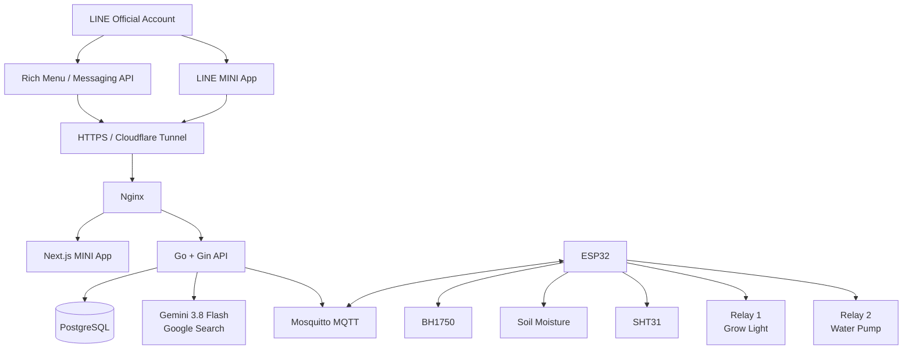
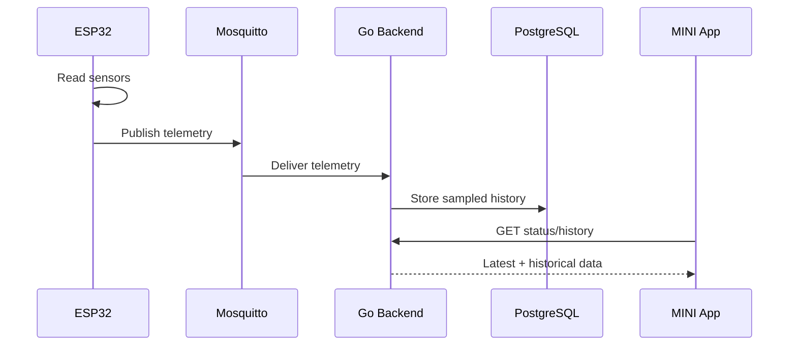
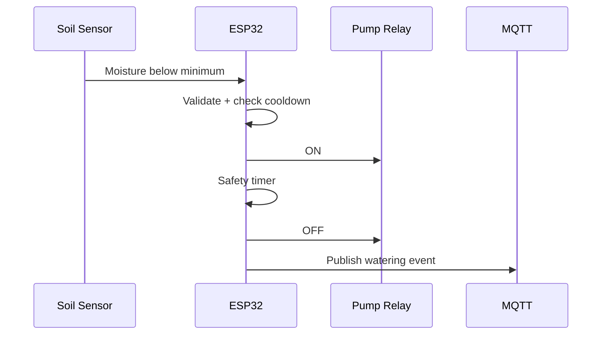
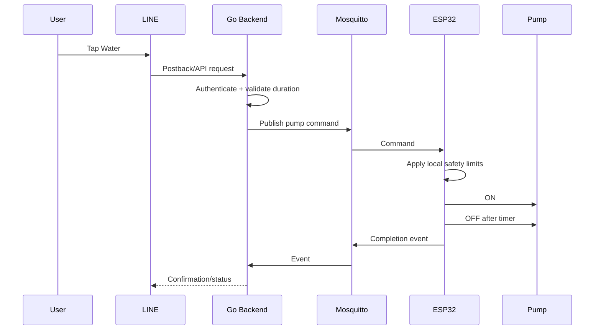
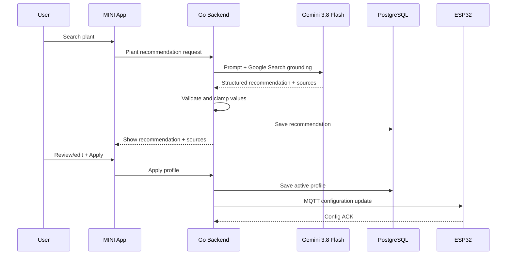

# Smart Farm — Project Overview

**Version:** 1.0  
**Date:** 2026-10-04  
**Project:** AI-assisted ESP32 Smart Farm controlled through LINE

---

## 1. Project Summary

Smart Farm is an IoT system that monitors a plant's environment and automatically controls two physical outputs:

- **Relay 1 → Grow Light**
- **Relay 2 → Water Pump**

An ESP32 reads light, soil moisture, temperature, and humidity. In AUTO mode, the ESP32 independently decides when to enable the grow light or perform a time-limited watering cycle using validated thresholds stored on the device.

Users interact with the farm through a **LINE MINI App** and **LINE Official Account Rich Menu**. The MINI App provides current status, manual controls, plant settings, AI recommendations, and complete history charts/events.

Google **Gemini 3.8 Flash** with **Google Search grounding** is used to research the requirements of a selected plant and generate a structured plant profile. The recommendation is validated by the backend before it can be applied to the ESP32.

---

## 2. Main Features

### Smart Monitoring

- Light intensity in lux.
- Soil moisture percentage after calibration.
- Temperature in °C.
- Relative humidity in %.
- ESP32 online/offline status.
- Relay state monitoring.

### Automatic Control

- Turn grow light ON when light is below the configured minimum.
- Turn grow light OFF when target light is reached.
- Start watering when soil moisture is below minimum.
- Stop the pump after a configured safe duration.
- Wait for a cooldown/soil-soak period before another automatic watering decision.

### LINE MINI App

- Current farm dashboard.
- AUTO / MANUAL state.
- Manual grow-light control.
- Safe time-limited watering.
- Plant selection.
- Gemini plant recommendation.
- History graphs.
- Watering history.
- Grow-light history.
- Automation log.
- Alert history.
- Device and safety settings.

### LINE Messaging API

- Rich Menu.
- Quick Status action.
- Open Dashboard action.
- Water action.
- Light action.
- AUTO mode action.
- Alerts and notifications.

### AI Plant Configuration

User chooses a plant, for example:

```text
Tomato
```

The backend requests Gemini to search reliable web sources for useful growing requirements. Gemini returns structured data such as:

```json
{
  "plant_name": "Tomato",
  "light": {
    "min_lux": 20000,
    "target_lux": 30000
  },
  "soil": {
    "moisture_min_percent": 35,
    "moisture_target_percent": 50
  }
}
```

The example values above are illustrative only. The real system uses grounded search results, validation, user review, sensor calibration, and safe bounds.

---

## 3. Core Architecture



### Why This Architecture

The public internet side and physical IoT side are separated:

```text
Internet / LINE
      |
      | HTTPS
      v
Go Backend
      |
      | Local MQTT
      v
Mosquitto
      |
      | LAN Wi-Fi
      v
ESP32
```

The ESP32 does not need a public IP, port forwarding, or an HTTP server exposed to the internet.

If the backend/server and ESP32 are on the same local network, Mosquitto can remain LAN-only. Cloudflare Tunnel exposes only the HTTPS application/webhook side.

---

## 4. Technology Stack

Stable/LTS production baseline verified on **2026-10-04**:

### IoT / Firmware

| Technology | Version / Choice | Purpose |
|---|---:|---|
| ESP32 | Hardware | Local controller |
| Arduino Core for ESP32 | **3.3.8** | Firmware framework |
| ESP-IDF | **5.5.4** through Arduino Core | Low-level ESP platform |
| C++ | ESP32 toolchain | Firmware language |
| MQTT client | Compatible ESP32 MQTT library | Device messaging |
| ArduinoJson | Compatible stable release | JSON parsing/config |

### Backend

| Technology | Version | Purpose |
|---|---:|---|
| Go | **1.27.1** | Backend language |
| Gin | **1.12.0** | HTTP REST API/webhooks |
| PostgreSQL | **18.6** | History/configuration/events |
| Eclipse Mosquitto | **2.1.2** | MQTT broker |

### LINE MINI App Frontend

| Technology | Version | Purpose |
|---|---:|---|
| Node.js | **24.21.0 LTS** | Frontend runtime/build |
| Next.js | **16.3.8 Active LTS** | MINI App frontend |
| React | **19.3.0** | UI |
| TypeScript | **6.0** | Type-safe frontend |
| Tailwind CSS | **4.3** | Styling |
| `@line/liff` | **2.31.1** | LINE/LIFF integration |

### AI

| Technology | Version | Purpose |
|---|---:|---|
| Gemini | **3.8 Flash** | Plant-requirement research and structured recommendations |
| Model ID | `gemini-3.8-flash` | Production API model |
| Google Search grounding | Current tool | Ground plant recommendations in web sources |

### Platform / Deployment

| Technology | Purpose |
|---|---|
| Docker | Containerization |
| Docker Compose | Local/server orchestration |
| Nginx | Reverse proxy |
| Cloudflare Tunnel | Public HTTPS access without exposing local web ports directly |
| Ubuntu Server | Host OS |

---

## 5. Responsibilities by Component

### ESP32

The ESP32 is responsible for real-time physical safety and local automation:

```text
Read sensors
    |
    v
Validate readings
    |
    v
AUTO control rules
    |
    +--> Relay 1: Light
    |
    +--> Relay 2: Pump
    |
    v
Publish telemetry/events via MQTT
```

It must continue to operate with the last valid configuration when internet connectivity is unavailable.

### Go Backend

The backend is responsible for:

- REST API.
- LINE webhook processing.
- LINE request/signature validation.
- LIFF user authorization.
- MQTT command publishing and telemetry subscription.
- Database access.
- History aggregation.
- Gemini integration.
- AI response validation.
- Plant profile management.
- Notifications.
- Audit/event logging.

### PostgreSQL

Stores:

- Users.
- Farms.
- Devices.
- Sensor history.
- Plant profiles.
- AI recommendations.
- Device configurations.
- Relay/actuator events.
- Alerts.

### Mosquitto

Acts as the local asynchronous message bus between the Go backend and ESP32.

### Next.js LINE MINI App

Provides mobile UI inside LINE:

```text
Home
History
Plant
Settings
```

### Gemini

Provides **recommendations only**.

Gemini must not directly control MQTT or ESP32 outputs.

---

## 6. Dashboard Design

### Home

```text
Smart Farm                 Online
Cactus                     AUTO

Temperature                Humidity
30.4 °C                    65 %

Light                      Soil
18,450 lux                 32 %
Target: 22,000             Target: 35 %

Grow Light                 Water Pump
ON                         OFF

[ Light Control ]          [ Water 5 sec ]
```

### History

Filters:

```text
[1 Hour] [24 Hours] [7 Days] [30 Days]
```

Charts:

- Light (lux).
- Soil moisture (%).
- Temperature (°C).
- Humidity (%).

Events:

```text
18:32  Pump ON   5 sec    AUTO_LOW_MOISTURE
18:37  Pump OFF           SAFETY_TIMER
18:40  Light ON           AUTO_LOW_LIGHT
19:25  Light OFF          TARGET_REACHED
```

### Plant

```text
Current Plant: Cactus

[ Search new plant ]

Gemini Recommendation
Light minimum: ...
Light target: ...
Moisture minimum: ...
Moisture target: ...
Temperature range: ...
Humidity range: ...

Sources
- Source A
- Source B

[ Edit ] [ Apply to Farm ]
```

### Settings

- AUTO / MANUAL / SAFE mode.
- Device ID.
- Sensor calibration.
- Pump maximum duration.
- Pump cooldown.
- Notification preferences.
- Device firmware information.

---

## 7. LINE Rich Menu

Recommended 6-button layout:

```text
+----------------+----------------+----------------+
| Dashboard      | Plant          | Status         |
| MINI App       | MINI App       | Bot/Postback   |
+----------------+----------------+----------------+
| Light          | Water          | Auto Mode      |
| Control        | 5 sec          | Toggle/Status  |
+----------------+----------------+----------------+
```

### Actions

**Dashboard**  
Opens LINE MINI App Home.

**Plant**  
Opens LINE MINI App Plant page.

**Status**  
Bot replies with current values and device state.

**Light**  
Issues authorized manual control or opens the relevant MINI App control.

**Water**  
Issues a predefined time-limited watering request such as 5 seconds.

**Auto Mode**  
Enables AUTO mode or opens mode controls.

---

## 8. Main Data Flows

### 8.1 Sensor Telemetry



### 8.2 Local Automatic Watering



The backend is not required for this action.

### 8.3 Manual Watering from LINE



### 8.4 Gemini Plant Recommendation



---

## 9. MQTT Topic Design

```text
smartfarm/{device_id}/telemetry
smartfarm/{device_id}/status
smartfarm/{device_id}/config/set
smartfarm/{device_id}/config/ack
smartfarm/{device_id}/command/light
smartfarm/{device_id}/command/pump
smartfarm/{device_id}/command/mode
smartfarm/{device_id}/event
```

Example:

```text
smartfarm/farm-001/command/pump
```

```json
{
  "request_id": "0cf4c40b",
  "duration_ms": 5000,
  "source": "LINE_MINI_APP"
}
```

---

## 10. Suggested REST API

```text
/api/v1
```

### Status

```http
GET /api/v1/farms/{farmId}/status
```

### History

```http
GET /api/v1/farms/{farmId}/history?range=24h
GET /api/v1/farms/{farmId}/events?range=7d
GET /api/v1/farms/{farmId}/alerts?range=30d
```

### Controls

```http
POST /api/v1/farms/{farmId}/mode
POST /api/v1/farms/{farmId}/light
POST /api/v1/farms/{farmId}/water
```

### Plant AI

```http
POST /api/v1/plants/recommend
GET  /api/v1/farms/{farmId}/plant-profile
PUT  /api/v1/farms/{farmId}/plant-profile
POST /api/v1/farms/{farmId}/plant-profile/apply
```

### LINE

```http
POST /webhooks/line
```

---

## 11. Suggested Database Tables

```text
users
farms
devices
sensor_readings
plant_profiles
ai_recommendations
device_configurations
actuator_events
alerts
```

Relationship overview:

```text
User
  |
  +-- Farm
       |
       +-- Device
       |    |
       |    +-- Sensor Readings
       |    +-- Device Configurations
       |    +-- Actuator Events
       |    +-- Alerts
       |
       +-- Plant Profiles
       +-- AI Recommendations
```

---

## 12. Recommended Repository Structure

```text
smart-farm/
|
+-- apps/
|   +-- mini-app/                 # Next.js 16 + React 19
|
+-- services/
|   +-- api/                      # Go + Gin
|
+-- firmware/
|   +-- esp32/                    # Arduino ESP32 firmware
|
+-- infra/
|   +-- docker-compose.yml
|   +-- nginx/
|   +-- mosquitto/
|   +-- postgres/
|
+-- docs/
|   +-- SRS.md
|   +-- architecture.md
|   +-- mqtt.md
|
+-- .env.example
+-- README.md
```

### Go Backend Structure

```text
services/api/
+-- cmd/server/
+-- internal/
|   +-- auth/
|   +-- farm/
|   +-- device/
|   +-- mqtt/
|   +-- line/
|   +-- plant/
|   +-- ai/
|   +-- history/
|   +-- alert/
|   +-- database/
|   +-- config/
+-- migrations/
+-- go.mod
```

### ESP32 Firmware Structure

```text
firmware/esp32/
+-- src/
|   +-- main.cpp
|   +-- sensors.cpp
|   +-- relays.cpp
|   +-- automation.cpp
|   +-- mqtt_client.cpp
|   +-- config_store.cpp
|   +-- safety.cpp
+-- include/
+-- platformio.ini or Arduino project files
```

---

## 13. Deployment Layout

Recommended local-server deployment:

```text
Ubuntu Server
|
+-- Docker Compose
    |
    +-- smartfarm-web       Next.js
    +-- smartfarm-api       Go
    +-- postgres            PostgreSQL
    +-- mosquitto           MQTT
    +-- nginx               Reverse Proxy

Cloudflare Tunnel
       |
       +--> https://smartfarm.example.com
       +--> https://smartfarm.example.com/api/*
       +--> https://smartfarm.example.com/webhooks/line

LAN
 |
 +--> ESP32 --> Mosquitto
```

Do not expose PostgreSQL publicly.

Prefer not to expose Mosquitto publicly when the ESP32 and server are on the same LAN.

---

## 14. Environment Variables

Backend example:

```text
APP_ENV=
HTTP_PORT=
DATABASE_URL=
MQTT_BROKER_URL=
MQTT_USERNAME=
MQTT_PASSWORD=
GEMINI_API_KEY=
LINE_CHANNEL_SECRET=
LINE_CHANNEL_ACCESS_TOKEN=
LINE_LOGIN_CHANNEL_ID=
```

Frontend example:

```text
NEXT_PUBLIC_LIFF_ID=
NEXT_PUBLIC_API_BASE_URL=
```

Never expose these in frontend variables:

```text
GEMINI_API_KEY
LINE_CHANNEL_SECRET
DATABASE_URL
MQTT_PASSWORD
```

---

## 15. Safety Rules

### Pump

The pump must never depend only on a remote ON/OFF command.

Every activation should have a maximum duration:

```text
Pump ON
   |
   +--> Max duration reached
   |
   v
Pump OFF
```

Recommended safety concepts:

- Maximum pump duration.
- Watering cooldown.
- Maximum activations per time window.
- Sensor validity checks.
- Pump OFF at boot.
- Pump OFF after command timeout.

### Grow Light

Use hysteresis:

```text
Lux < minimum       -> Light ON
Lux >= target       -> Light OFF
```

This prevents rapid ON/OFF switching close to one threshold.

---

## 16. Important Design Decision: Local AUTO Logic

Bad architecture:

```text
Sensor -> Internet -> AI -> Backend -> Internet -> ESP32 -> Relay
```

If the internet fails, automation fails.

Selected architecture:

```text
            +--> MQTT telemetry --> Backend
            |
Sensor --> ESP32 --> Local rule --> Relay
            ^
            |
        Configuration
```

Gemini and the backend help configure the farm, while the ESP32 remains capable of running it.

---

## 17. History Strategy

Recommended collection behavior:

```text
ESP32 sensor sample       every ~5 sec
MQTT telemetry            every ~30 sec
Database history sample   every ~1 min
```

These values should be configurable.

For longer ranges, backend queries may aggregate readings:

```text
1 hour    -> fine resolution
24 hours  -> 1-5 minute buckets
7 days    -> 15 minute buckets
30 days   -> hourly buckets
```

This keeps charts fast and avoids unnecessary database growth.

---

## 18. MVP Development Order

### Phase 1 — ESP32 Hardware

- Read BH1750.
- Read soil moisture.
- Read SHT31.
- Control Relay 1.
- Control Relay 2.
- Implement safe local AUTO logic.

### Phase 2 — MQTT

- Install Mosquitto.
- ESP32 publish telemetry.
- ESP32 subscribe to commands/configuration.
- Implement reconnect and device heartbeat.

### Phase 3 — Go Backend

- Gin API.
- PostgreSQL migrations.
- MQTT subscriber/publisher.
- Save telemetry.
- Device status endpoints.
- Control endpoints.

### Phase 4 — LINE MINI App

- LIFF authentication.
- Home dashboard.
- Manual controls.
- History charts.
- Plant settings.

### Phase 5 — LINE Messaging API

- Webhook.
- Signature verification.
- Rich Menu.
- Status command.
- Water/light commands.
- Notifications.

### Phase 6 — Gemini

- Gemini 3.8 Flash integration.
- Google Search grounding.
- Structured response schema.
- Source display.
- Validation and apply flow.

### Phase 7 — Testing and Deployment

- Safety tests.
- Offline tests.
- Sensor failure tests.
- LINE authorization tests.
- Pump timeout tests.
- Cloudflare HTTPS deployment.

---

## 19. Definition of Done

The project is ready for university demonstration when a reviewer can observe this full flow:

```text
1. Select a plant in LINE MINI App
              |
              v
2. Gemini searches plant requirements
              |
              v
3. User reviews and applies settings
              |
              v
4. Backend sends config to ESP32
              |
              v
5. ESP32 automatically controls light/water
              |
              v
6. Sensor readings appear in dashboard
              |
              v
7. History chart records changes
              |
              v
8. User controls farm through LINE
              |
              v
9. Disconnect internet
              |
              v
10. ESP32 AUTO control still works
```

That last offline demonstration is an important technical strength of the architecture.

---

## 20. Project Elevator Pitch

> **Smart Farm is an ESP32-based plant monitoring and automation system integrated with LINE. The ESP32 controls lighting and irrigation locally using sensor data, while a LINE MINI App provides live monitoring, manual control, plant settings, and historical analytics. Gemini with Google Search grounding researches plant-specific environmental requirements and generates validated configuration recommendations. MQTT connects the backend to the local ESP32, while PostgreSQL stores sensor and automation history. The design keeps physical automation safe and operational even when the internet is unavailable.**
