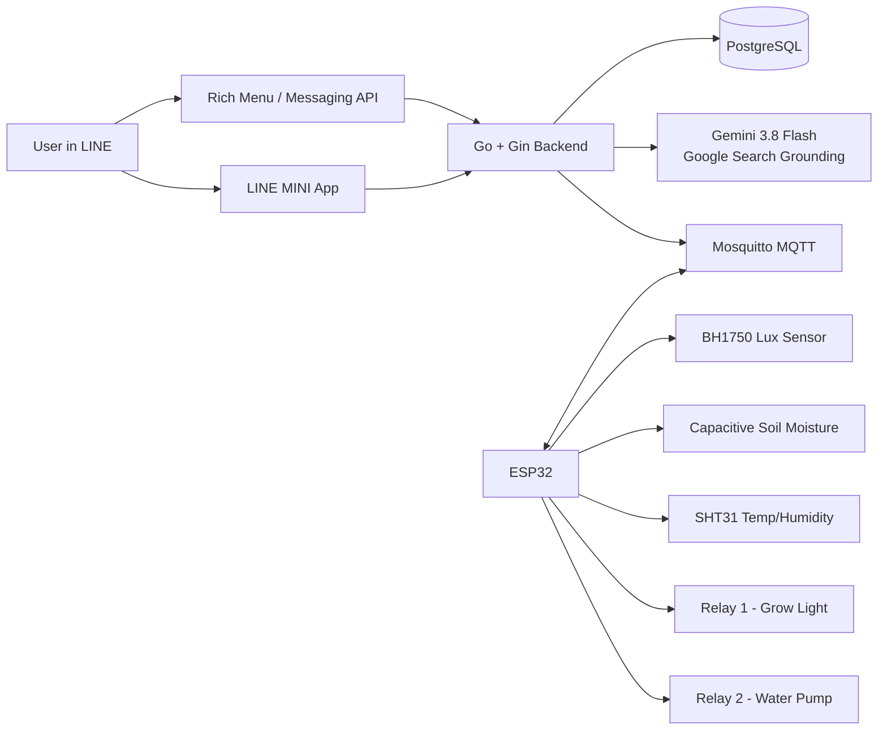

# Smart Farm — Software Requirements Specification (SRS)

**Document version:** 1.0  
**Date:** 2026-10-04  
**Status:** Project baseline / implementation-ready draft  
**Project type:** ESP32 Smart Farm + LINE MINI App + LINE Messaging API + AI-assisted plant configuration

---

## 1. Purpose

This Software Requirements Specification defines the requirements for a Smart Farm system that monitors environmental conditions and automatically controls a grow light and water pump through an ESP32.

The system combines local IoT automation with a web backend, a LINE MINI App dashboard, LINE Messaging API/Rich Menu controls, historical sensor data, and Google Gemini with Google Search grounding to recommend plant-specific settings.

A core design rule is that **AI recommends settings, but AI does not directly switch physical relays**. The ESP32 remains responsible for safe local automation so the farm can continue operating even when the internet, backend, Gemini API, or LINE is unavailable.

---

## 2. System Goals

1. Measure light level, soil moisture, temperature, and air humidity.
2. Automatically switch Relay 1 (grow light) when light is insufficient.
3. Automatically switch Relay 2 (water pump) when soil moisture is insufficient.
4. Allow users to monitor and control the farm through a LINE MINI App.
5. Allow quick commands through LINE Official Account Rich Menu and Messaging API.
6. Use Gemini + Google Search grounding to find plant care requirements and convert them into configurable thresholds.
7. Store sensor history, relay activity, alerts, and automation events in PostgreSQL.
8. Continue basic automatic control locally on the ESP32 when internet connectivity is lost.
9. Apply safety rules to prevent a failed sensor or network command from leaving the pump or light running indefinitely.

---

## 3. Product Scope

### 3.1 In Scope

- ESP32 sensor acquisition.
- BH1750 light/lux sensing.
- Capacitive soil moisture sensing.
- Temperature and humidity sensing using SHT31 or equivalent.
- Relay 1 for grow light.
- Relay 2 for water pump.
- Automatic and manual operating modes.
- MQTT communication between ESP32 and backend infrastructure.
- Go REST API and LINE webhook backend.
- LINE MINI App dashboard.
- LINE Rich Menu and chat commands.
- Gemini plant-requirement search with Google Search grounding.
- Plant profiles and threshold configuration.
- Sensor and actuator history.
- Alerts and LINE notifications.
- Local fail-safe behavior.
- Docker Compose based deployment.

### 3.2 Out of Scope for MVP

- Computer vision / plant disease detection.
- Automatic fertilizer or nutrient dosing.
- pH/EC dosing control.
- Variable-speed pump control.
- Multiple irrigation zones per ESP32.
- Weather-station integration.
- Commercial greenhouse certification.
- Fully autonomous AI control of physical actuators.

These can be added in later releases.

---

## 4. Production Technology Baseline

Versions below are the stable/LTS production baseline verified on **2026-10-04**. Beta/preview infrastructure releases are intentionally excluded.

| Layer | Technology | Baseline Version |
|---|---|---:|
| IoT MCU | ESP32 | Hardware platform |
| ESP32 framework | Arduino Core for ESP32 | **3.3.8** |
| ESP32 base SDK | ESP-IDF | **5.5.4** (via Arduino Core 3.3.8) |
| ESP32 language | C++ / Arduino | Toolchain provided by ESP32 core |
| Backend language | Go | **1.27.1** |
| Backend framework | Gin | **1.12.0** |
| Database | PostgreSQL | **18.6** |
| MQTT broker | Eclipse Mosquitto | **2.1.2** |
| Frontend runtime | Node.js | **24.21.0 LTS** |
| Frontend framework | Next.js | **16.3.8 Active LTS** |
| UI library | React | **19.3.0** |
| Language | TypeScript | **6.0** |
| Styling | Tailwind CSS | **4.3** |
| LINE web SDK | `@line/liff` | **2.31.1** |
| LINE integration | Messaging API + Rich Menu + LINE MINI App | Current API |
| AI model | Gemini | **Gemini 3.8 Flash (`gemini-3.8-flash`)** |
| AI web grounding | Gemini Google Search tool | Current supported tool |
| Containers | Docker + Docker Compose | Latest stable compatible release |
| Reverse proxy | Nginx | Latest stable repository release |
| Public HTTPS | Cloudflare Tunnel | Current supported release |

> PostgreSQL 19 was still pre-GA at the time of this baseline, so PostgreSQL 18.6 is selected for production stability.

---

## 5. System Context



### Deployment Principle

For the preferred local-server deployment:

- Go backend, PostgreSQL, Mosquitto, and Next.js run on the local Ubuntu server.
- ESP32 connects to Mosquitto through the local LAN.
- MQTT does **not** need to be exposed publicly.
- LINE webhook and LINE MINI App are exposed through HTTPS using Cloudflare Tunnel/Nginx.
- The backend publishes commands to the local Mosquitto broker.

This keeps the physical-device control path private while still allowing remote LINE control.

---

## 6. User Roles

### 6.1 Farm Owner

The Farm Owner shall be able to:

- View real-time farm status.
- View sensor history.
- View watering/light/automation/alert history.
- Select or change the plant profile.
- Request a new AI plant recommendation.
- Apply or modify recommended thresholds.
- Enable AUTO mode.
- Switch to MANUAL mode.
- Manually control the grow light.
- Trigger a time-limited watering action.
- Receive LINE alerts.

### 6.2 System / ESP32

The ESP32 acts as a trusted device and shall:

- Read sensors.
- Execute local AUTO rules.
- Apply safety constraints.
- Receive configuration via MQTT.
- Receive authorized manual commands via MQTT.
- Publish telemetry and device status.
- Continue local automation during internet/backend outage.

### 6.3 AI Recommendation Service

Gemini shall only:

- Search for plant-care information.
- Produce structured recommended settings.
- Return sources/grounding metadata when available.

Gemini shall **not** directly publish MQTT commands or control relays.

---

## 7. Hardware Requirements

| Component | Purpose |
|---|---|
| ESP32 development board | Main controller |
| BH1750 | Ambient light measurement in lux |
| Capacitive soil moisture sensor | Soil moisture measurement |
| SHT31 (preferred) or DHT22 | Temperature and relative humidity |
| 2-channel relay module | Control light and pump |
| Relay 1 | Grow light ON/OFF |
| Relay 2 | Water pump ON/OFF |
| Appropriate DC water pump | Irrigation |
| Grow light | Supplemental lighting |
| Proper power supply | Power ESP32, sensors, relay and loads safely |

### 7.1 Sensor Calibration Requirement

The soil moisture sensor shall be calibrated for at least:

- `dry_raw`
- `wet_raw`

The firmware shall map calibrated raw readings into a project-specific moisture percentage.

A percentage found on the internet must **not** be assumed to equal an uncalibrated sensor percentage.

---

## 8. Functional Requirements

### FR-001 — Device Identity

Each ESP32 shall have a unique `device_id`, for example:

`farm-001`

The device ID shall be included in MQTT topics and backend records.

### FR-002 — Device Connectivity

The ESP32 shall connect to Wi-Fi and then to the configured MQTT broker.

The ESP32 shall automatically reconnect after temporary Wi-Fi or MQTT failure without blocking local automation.

### FR-003 — Device Heartbeat

The ESP32 shall publish a heartbeat/status message periodically.

The backend shall mark the device offline if no heartbeat is received within a configurable timeout.

---

### FR-010 — Sensor Acquisition

The ESP32 shall measure:

- Light level in lux.
- Soil moisture as calibrated percentage.
- Air temperature in °C.
- Relative humidity in %RH.

Default local sensor sampling interval: **5 seconds**.

The interval shall be configurable.

### FR-011 — Telemetry Publishing

The ESP32 shall publish telemetry through MQTT.

Recommended default telemetry publish interval: **30 seconds**.

The backend may downsample before long-term storage.

### FR-012 — Historical Sensor Storage

The backend shall persist sensor readings for use in the History dashboard.

Default history storage interval: **1 minute** per device.

The exact retention and downsampling policy shall be configurable.

---

### FR-020 — Automatic Light Control

In AUTO mode:

- If `lux < light_min_lux`, Relay 1 shall turn the grow light ON.
- If `lux >= light_target_lux`, Relay 1 shall turn the grow light OFF.

The system shall use separate ON and OFF thresholds (hysteresis) to prevent rapid relay switching.

Example:

```text
light_min_lux    = 15,000
light_target_lux = 22,000
```

### FR-021 — Automatic Watering

In AUTO mode:

- If soil moisture is below `moisture_min_percent`, the ESP32 may activate the water pump.
- Pump operation shall always be time-limited.
- After watering, the ESP32 shall enter a configurable cooldown/soak period before deciding to water again.

### FR-022 — Pump Safety

The firmware shall support:

- Maximum pump ON duration per activation.
- Minimum cooldown between watering activations.
- Maximum number of pump activations during a configured time window.
- Immediate pump OFF on invalid configuration.
- Immediate pump OFF on firmware boot until initialization is complete.

The pump shall not remain continuously ON because of a network disconnect.

### FR-023 — Invalid Sensor Fail-safe

If the soil moisture sensor is disconnected, outside valid calibrated range, or repeatedly invalid:

- Automatic watering shall be suspended.
- The pump shall be OFF.
- An alert event shall be generated.

If the light sensor is invalid:

- The system shall avoid uncontrolled relay oscillation.
- The failure shall be logged and reported.

---

### FR-030 — Operating Modes

The system shall support:

#### AUTO

ESP32 uses configured thresholds and local sensor values to control relays.

#### MANUAL

The user may issue commands from LINE MINI App or LINE Rich Menu.

Safety limits still apply in MANUAL mode, especially to pump duration.

#### OFF / SAFE

Physical outputs are forced to their configured safe state.

---

### FR-031 — Manual Grow Light Control

Authorized users shall be able to request:

- Light ON.
- Light OFF.

The backend shall publish an MQTT command to the selected device.

The ESP32 shall publish the resulting relay state.

### FR-032 — Manual Watering

Authorized users shall be able to request a time-limited watering action, such as 5 seconds.

The backend shall reject durations outside configured safety limits.

The ESP32 shall independently enforce the maximum duration even if the backend sends an invalid value.

---

### FR-040 — Plant Search

The LINE MINI App shall allow the user to enter or select a plant name.

The backend shall query Gemini with Google Search grounding for relevant plant-care information.

The AI request should seek information such as:

- Recommended light intensity.
- Recommended daily light/photoperiod when reliable information is available.
- Soil moisture preference.
- Watering behavior.
- Temperature range.
- Humidity range.

### FR-041 — Structured AI Response

The backend shall require a structured response that can be validated before storage.

Example logical schema:

```json
{
  "plant_name": "Cactus",
  "light": {
    "min_lux": 15000,
    "target_lux": 22000,
    "photoperiod_hours": 12
  },
  "soil": {
    "moisture_min_percent": 25,
    "moisture_target_percent": 35
  },
  "temperature": {
    "min_c": 18,
    "max_c": 32
  },
  "humidity": {
    "min_percent": 30,
    "max_percent": 60
  },
  "notes": "Example only"
}
```

The values above are examples and are not universal plant requirements.

### FR-042 — AI Validation

Before an AI recommendation becomes an active device configuration:

- Required fields shall be validated.
- Values shall be clamped to system-safe ranges.
- The backend shall store the recommendation separately from the currently active configuration.
- The user shall be able to review/edit the recommendation before applying it.

### FR-043 — AI Source Visibility

When grounding metadata is available, the MINI App shall display the source titles/links or an equivalent source list so the recommendation can be reviewed.

### FR-044 — AI Isolation from Actuators

Gemini shall never:

- Connect directly to Mosquitto.
- Publish relay commands.
- Bypass backend validation.
- Bypass ESP32 safety rules.

---

### FR-050 — LINE MINI App Dashboard

The Home dashboard shall show:

- Current plant.
- ESP32 online/offline state.
- Current operating mode.
- Temperature.
- Humidity.
- Lux.
- Soil moisture.
- Grow light state.
- Pump state.
- Current target/threshold values.
- Last telemetry timestamp.

### FR-051 — Dashboard Controls

The dashboard shall provide:

- AUTO / MANUAL control.
- Light ON/OFF in MANUAL mode.
- Time-limited Water action.
- Plant selection.
- Link to History.

### FR-052 — History Dashboard

The History page shall provide time-series charts for:

- Lux.
- Soil moisture.
- Temperature.
- Humidity.

Supported default filters:

- 1 hour.
- 24 hours.
- 7 days.
- 30 days.

### FR-053 — Actuator History

The History page shall show events for:

- Pump ON/OFF.
- Grow light ON/OFF.
- Manual commands.
- Automatic commands.
- Duration when applicable.
- Reason for action.

Example reasons:

- `AUTO_LOW_LIGHT`
- `AUTO_LOW_MOISTURE`
- `MANUAL_LINE`
- `MANUAL_MINI_APP`
- `SAFETY_TIMEOUT`

### FR-054 — Alert History

The system shall retain and display alerts such as:

- Device offline.
- Soil moisture sensor failure.
- Light sensor failure.
- Excessive watering attempts.
- MQTT connection loss.
- Invalid configuration.

---

### FR-060 — LINE Messaging API

The backend shall implement a LINE webhook endpoint.

The webhook shall verify the LINE request signature before processing the event.

### FR-061 — LINE Rich Menu

The LINE Official Account shall provide a Rich Menu with functions similar to:

```text
+----------------+----------------+----------------+
| Dashboard      | Plant Setting  | Status         |
+----------------+----------------+----------------+
| Light          | Water          | Auto Mode      |
+----------------+----------------+----------------+
```

Recommended actions:

- Dashboard → open LINE MINI App.
- Plant Setting → open MINI App plant page.
- Status → Messaging API postback or message action.
- Light → manual command or MINI App control.
- Water → safe time-limited watering postback.
- Auto Mode → mode command.

### FR-062 — LINE Notifications

The backend may send notifications for significant events, including:

- Low moisture and automatic watering activation.
- Sensor failure.
- Device offline.
- Safety shutdown.

Notification rules shall support rate limiting to avoid spam.

---

### FR-070 — Offline Operation

If internet/backend connectivity is unavailable, the ESP32 shall continue AUTO mode using the last valid locally stored configuration.

Manual remote control and cloud history may be temporarily unavailable, but basic farm automation must continue.

### FR-071 — Configuration Persistence

The ESP32 shall persist the last validated configuration in non-volatile storage so it can restore operation after reboot.

### FR-072 — Configuration Versioning

Configurations shall include a monotonically increasing version or timestamp.

The ESP32 shall acknowledge the applied configuration version.

---

### FR-080 — Authentication and Authorization

The MINI App shall use LINE/LIFF identity.

The backend shall verify authentication tokens server-side before accepting protected API operations.

A LINE user shall only be able to access farms/devices mapped to that account.

### FR-081 — Audit Logging

The system shall record who or what caused a device action:

- ESP32 AUTO logic.
- LINE user.
- MINI App user.
- Backend safety rule.

---

## 9. Suggested MQTT Contract

### 9.1 Topics

```text
smartfarm/{device_id}/telemetry
smartfarm/{device_id}/status
smartfarm/{device_id}/config/set
smartfarm/{device_id}/config/ack
smartfarm/{device_id}/command/light
smartfarm/{device_id}/command/pump
smartfarm/{device_id}/command/mode
smartfarm/{device_id}/event
```

### 9.2 Telemetry Example

```json
{
  "device_id": "farm-001",
  "ts": "2026-10-04T12:00:00Z",
  "temperature_c": 30.4,
  "humidity_percent": 65.2,
  "lux": 18450,
  "soil_moisture_percent": 32.1,
  "light_on": true,
  "pump_on": false,
  "mode": "AUTO",
  "config_version": 12
}
```

### 9.3 Pump Command Example

Topic:

```text
smartfarm/farm-001/command/pump
```

Payload:

```json
{
  "request_id": "req-123",
  "action": "ON",
  "duration_ms": 5000,
  "source": "LINE_MINI_APP"
}
```

### 9.4 Configuration Example

```json
{
  "version": 12,
  "mode": "AUTO",
  "light": {
    "min_lux": 15000,
    "target_lux": 22000
  },
  "watering": {
    "moisture_min_percent": 25,
    "moisture_target_percent": 35,
    "pump_duration_ms": 5000,
    "cooldown_seconds": 300,
    "max_pump_duration_ms": 10000
  }
}
```

---

## 10. REST API Requirements

Suggested API namespace:

`/api/v1`

### Farm and Status

```http
GET /api/v1/farms
GET /api/v1/farms/{farmId}
GET /api/v1/farms/{farmId}/status
```

### History

```http
GET /api/v1/farms/{farmId}/history?range=24h
GET /api/v1/farms/{farmId}/events?range=7d
GET /api/v1/farms/{farmId}/alerts?range=30d
```

### Controls

```http
POST /api/v1/farms/{farmId}/mode
POST /api/v1/farms/{farmId}/light
POST /api/v1/farms/{farmId}/water
```

### Plant and AI

```http
POST /api/v1/plants/recommend
GET  /api/v1/farms/{farmId}/plant-profile
PUT  /api/v1/farms/{farmId}/plant-profile
POST /api/v1/farms/{farmId}/plant-profile/apply
```

### LINE

```http
POST /webhooks/line
```

---

## 11. Data Model Requirements

### `users`

- `id`
- `line_user_id`
- `display_name`
- `created_at`
- `updated_at`

### `farms`

- `id`
- `owner_user_id`
- `name`
- `timezone`
- `created_at`

### `devices`

- `id`
- `farm_id`
- `device_uid`
- `name`
- `firmware_version`
- `last_seen_at`
- `status`

### `sensor_readings`

- `id`
- `device_id`
- `temperature_c`
- `humidity_percent`
- `lux`
- `soil_moisture_percent`
- `recorded_at`

### `plant_profiles`

- `id`
- `farm_id`
- `plant_name`
- `light_min_lux`
- `light_target_lux`
- `moisture_min_percent`
- `moisture_target_percent`
- `temperature_min_c`
- `temperature_max_c`
- `humidity_min_percent`
- `humidity_max_percent`
- `source_type`
- `active`
- `created_at`

### `ai_recommendations`

- `id`
- `farm_id`
- `plant_name`
- `model`
- `raw_response`
- `validated_profile_json`
- `grounding_metadata_json`
- `created_at`

### `actuator_events`

- `id`
- `device_id`
- `actuator`
- `action`
- `duration_ms`
- `source`
- `reason`
- `request_id`
- `recorded_at`

### `alerts`

- `id`
- `device_id`
- `severity`
- `type`
- `message`
- `acknowledged_at`
- `created_at`

### `device_configurations`

- `id`
- `device_id`
- `version`
- `config_json`
- `applied_at`
- `created_at`

---

## 12. Non-Functional Requirements

### NFR-001 — Reliability

- ESP32 AUTO control shall not depend on continuous internet access.
- A backend restart shall not cause the pump to remain ON.
- The ESP32 shall recover MQTT connectivity automatically.

### NFR-002 — Safety

- Pump commands must always have an upper time limit.
- Invalid moisture readings must fail to pump OFF.
- Relay outputs must initialize to known safe states at boot.
- Backend safety checks and ESP32 safety checks shall both exist.

### NFR-003 — Performance

Under normal project load:

- MINI App status API target response: under 500 ms on LAN/server under normal conditions.
- Manual command should normally reach MQTT within 1 second after backend acceptance.
- ESP32 local AUTO reaction should not depend on network round trips.

### NFR-004 — Security

- All public web traffic shall use HTTPS.
- LINE webhook signatures shall be verified.
- LIFF identity/authentication shall be verified server-side.
- Gemini API key, LINE Channel Secret, database credentials, and other secrets shall not be compiled into ESP32 firmware or frontend JavaScript.
- MQTT shall be private to LAN where possible.
- MQTT authentication shall be used.
- PostgreSQL shall not be publicly exposed.
- Secrets shall be stored in server-side environment/secrets files.

### NFR-005 — Privacy

Only required LINE identity fields shall be stored.

Sensitive access tokens shall not be logged.

### NFR-006 — Maintainability

- Backend modules shall separate HTTP, LINE, MQTT, AI, database, and business logic.
- MQTT topic formats shall be documented and versionable.
- Device firmware shall separate sensor drivers, relay control, automation logic, configuration, and transport.

### NFR-007 — Observability

The backend shall log:

- API failures.
- LINE webhook failures.
- MQTT connection events.
- Invalid telemetry.
- AI request failures.
- Configuration application failures.

### NFR-008 — Usability

The MINI App shall be mobile-first and usable within the LINE in-app browser.

Critical controls such as Water shall clearly display duration and action state.

---

## 13. LINE MINI App Information Architecture

```text
HOME
├── Current plant
├── Device online/offline
├── AUTO / MANUAL state
├── Temperature
├── Humidity
├── Light
├── Soil moisture
├── Relay states
└── Quick controls

HISTORY
├── Sensor charts
│   ├── Lux
│   ├── Soil moisture
│   ├── Temperature
│   └── Humidity
├── Watering history
├── Grow-light history
├── Automation events
└── Alerts

PLANT
├── Current profile
├── Search plant with Gemini
├── Sources
├── Recommended thresholds
├── Edit thresholds
└── Apply configuration

SETTINGS
├── Device information
├── Sensor calibration
├── Pump safety
├── Notification settings
└── System information
```

Recommended bottom navigation:

```text
Home | History | Plant | Settings
```

---

## 14. Key Use Cases

### UC-01 — View Current Farm Status

**Actor:** Farm Owner  
**Precondition:** User is authenticated through LINE MINI App.  
**Flow:**

1. MINI App requests farm status.
2. Backend verifies user and farm access.
3. Backend returns latest telemetry and device state.
4. Dashboard displays sensor values and relay states.

**Success:** User sees latest known farm status and timestamp.

### UC-02 — Automatic Grow Light

**Actor:** ESP32  
**Precondition:** AUTO mode and valid light sensor/configuration.  
**Flow:**

1. ESP32 measures lux below minimum.
2. ESP32 turns Relay 1 ON.
3. ESP32 publishes event/state.
4. When lux reaches target, Relay 1 turns OFF.

**Success:** Light is controlled without backend dependency.

### UC-03 — Automatic Watering

**Actor:** ESP32  
**Precondition:** AUTO mode, valid moisture sensor, cooldown expired.  
**Flow:**

1. Moisture falls below minimum.
2. ESP32 runs pump for configured duration.
3. Pump turns OFF automatically.
4. Cooldown/soak interval begins.
5. Event is published and stored.

**Success:** Watering completes without continuous-pump risk.

### UC-04 — Manual Water from LINE

**Actor:** Farm Owner  
**Flow:**

1. User taps Water from MINI App or Rich Menu.
2. Backend authenticates the user.
3. Backend validates requested duration.
4. Backend publishes MQTT pump command.
5. ESP32 applies local maximum-duration rule.
6. ESP32 runs pump and publishes completion event.
7. Backend stores the event.

### UC-05 — Search and Apply Plant Profile

**Actor:** Farm Owner  
**Flow:**

1. User enters a plant name.
2. Backend asks Gemini 3.8 Flash with Google Search grounding.
3. Gemini returns recommendation plus grounding information.
4. Backend validates and stores recommendation.
5. MINI App displays values and sources.
6. User reviews/edits and taps Apply.
7. Backend saves active plant profile and publishes configuration version.
8. ESP32 validates and acknowledges the new configuration.

### UC-06 — View History

**Actor:** Farm Owner  
**Flow:**

1. User opens History.
2. User chooses 1h, 24h, 7d, or 30d.
3. Backend queries historical data.
4. MINI App displays sensor charts and actuator events.

---

## 15. Acceptance Criteria for MVP

The MVP is considered functionally complete when all of the following are demonstrated:

- [ ] ESP32 reads all required sensors.
- [ ] Relay 1 controls the grow light.
- [ ] Relay 2 controls the pump.
- [ ] AUTO light control works using minimum/target thresholds.
- [ ] AUTO watering uses a time-limited pump action and cooldown.
- [ ] Pump automatically turns OFF after its allowed duration.
- [ ] ESP32 continues AUTO mode when backend connection is removed.
- [ ] ESP32 telemetry reaches Mosquitto and backend.
- [ ] Backend stores historical sensor readings in PostgreSQL.
- [ ] MINI App displays real-time/latest values.
- [ ] MINI App displays history charts.
- [ ] MINI App displays watering/light/automation/alert history.
- [ ] User can manually control light from LINE/MINI App.
- [ ] User can trigger safe watering from LINE/MINI App.
- [ ] LINE Rich Menu can open the MINI App and trigger defined actions.
- [ ] LINE webhook signature validation is enabled.
- [ ] Gemini searches for plant requirements with Google Search grounding.
- [ ] AI response is validated before it can become device configuration.
- [ ] Gemini cannot directly control relays.
- [ ] Secrets are server-side only.

---

## 16. Future Enhancements

- Multi-device / multi-zone farms.
- PAR/PPFD sensor and Daily Light Integral (DLI) calculations.
- Water reservoir level sensor.
- Flow sensor to confirm real watering.
- Pump dry-run protection.
- pH and EC monitoring.
- Nutrient dosing.
- Camera-based growth monitoring.
- Plant disease detection.
- Weather-aware automation.
- Forecast-based watering.
- Advanced alert analytics.
- CSV/Excel history export.
- Role-based farm sharing.

---

## 17. Notes on Plant Light Recommendations

BH1750 reports **lux**, which is convenient and inexpensive but is not the ideal horticultural unit for all plant-light decisions. Professional grow-light systems often use PPFD and DLI. For the MVP, the project uses lux because it matches the selected sensor; the AI recommendation should clearly expose assumptions and sources. A PAR/PPFD sensor can be added in a future version.

---

## 18. Version Baseline Policy

Before implementation or deployment, run a dependency review and update patch versions where compatible. Major upgrades should be tested before adoption.

The versions in Section 4 are a verified baseline as of 2026-10-04 and are intentionally chosen from stable/LTS releases suitable for this project rather than preview/beta versions.
